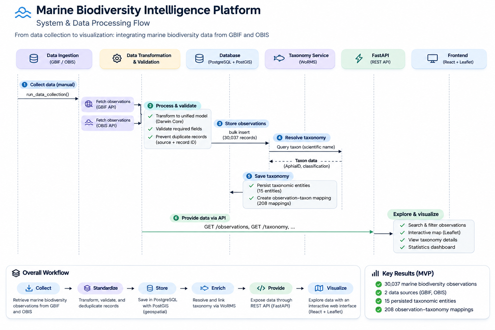

# Marine Biodiversity Intelligence Platform

An open-source platform for integrating, standardizing, exploring,
and visualizing marine biodiversity observations.




## 1. Overview

Marine biodiversity observations are distributed across multiple international databases, each with different data structures, identifiers, and taxonomic representations.

The Marine Biodiversity Intelligence Platform addresses this fragmentation by providing a unified data integration pipeline.

The current implementation focuses on:

- Collecting marine biodiversity observations from GBIF and OBIS.
- Transforming source-specific records into a common observation model.
- Preventing duplicate records through source-based identifiers.
- Storing observation and geospatial data in PostgreSQL with PostGIS.
- Connecting observations with taxonomic information through WoRMS.
- Exposing biodiversity data through REST APIs.
- Exploring observation records through an interactive map interface.

## 2. Dataset Overview

The current MVP database contains:

| Metric | Value |
|---|---:|
| Total canonical observations | 30,037 |
| GBIF raw records | 15,020 |
| OBIS raw records | 15,020 |
| Persisted taxonomic entities | 15 |
| Observation-level taxonomy mappings | 208 |

**Taxonomy data note:** The 15 taxonomic entities and 208 observation-level mappings represent a separately processed taxonomy subset, not the complete dataset of 30,037 observations.

## 3. Key Features

### 3.1 Biodiversity Data Integration

Integration of two major international biodiversity data providers:

- GBIF — Global Biodiversity Information Facility
- OBIS — Ocean Biodiversity Information System

Source-specific ingestion services collect marine biodiversity observations and preserve their original records.

### 3.2 Data Standardization

Heterogeneous source records are transformed into a unified observation model.

The pipeline includes:

- Source-specific data transformation.
- Observation validation.
- Consistent representation of observation records.
- Duplicate prevention using source and source-record identifiers.
- Batch processing for efficient database insertion.

### 3.3 Taxonomic Integration

Integration with WoRMS (World Register of Marine Species) for taxonomic resolution.

Implemented functionality includes:

- Taxonomic name resolution.
- AphiaID-based taxon identification.
- Persistent taxonomic entity storage.
- Observation-level taxonomy relationships.
- Reuse of existing taxonomic records.
- Duplicate mapping prevention.

### 3.4 Geospatial Visualization

Interactive exploration of marine biodiversity observations through a React and Leaflet-based map interface.

The frontend provides:

- Observation statistics.
- Geographic observation visualization.
- Taxonomic filtering.
- Data-source filtering.
- Observation search and pagination.

### 3.5 REST API

FastAPI provides endpoints for:

- Health checks.
- Observation data retrieval.
- Data collection management.
- Taxonomic information retrieval.

Interactive API documentation is available through Swagger UI and ReDoc.

## 4. Architecture

The platform follows a modular data pipeline architecture.

```text
        Biodiversity Data Providers
                  |
          +-------+-------+
          |               |
         GBIF            OBIS
          |               |
          v               v
    GBIF Ingestion   OBIS Ingestion
          |               |
          v               v
      Raw GBIF         Raw OBIS
       Records          Records
          |               |
          +-------+-------+
                  |
                  v
        Data Transformation
                  |
                  v
       Unified Observation Model
                  |
                  v
        PostgreSQL + PostGIS
                  |
          +-------+-------+
          |               |
          v               v
       FastAPI       Taxonomic Data
          |           Integration
          |             WoRMS
          v
      React Frontend
          |
          v
    Leaflet Map Interface
```

## 5. Technology Stack

| Component | Technology |
|---|---|
| Backend | Python, FastAPI |
| API Server | Uvicorn |
| ORM | SQLAlchemy |
| Data Validation | Pydantic |
| Database | PostgreSQL 16 |
| Geospatial Database | PostGIS 3.4 |
| Geospatial ORM | GeoAlchemy2 |
| External API Communication | HTTPX |
| Frontend | React 19 |
| Programming Language | TypeScript 6 |
| Build Tool | Vite |
| HTTP Client | Axios |
| Map Visualization | Leaflet, React-Leaflet |
| Containerization | Docker, Docker Compose |
| Testing | Pytest |
| Taxonomic Data | WoRMS |

## 6. Project Structure

```text
marine-biodiversity-platform/
│
├── backend/
│   ├── app/
│   │   ├── api/
│   │   │   ├── data_collection_routes.py
│   │   │   ├── health.py
│   │   │   ├── observation_routes.py
│   │   │   └── taxonomy_routes.py
│   │   │
│   │   ├── db/
│   │   ├── models/
│   │   ├── schemas/
│   │   └── services/
│   │       ├── gbif_ingestion.py
│   │       ├── gbif_transformer.py
│   │       ├── obis_ingestion.py
│   │       ├── obis_transformer.py
│   │       ├── worms_service.py
│   │       └── taxonomy_persistence_service.py
│   │
│   ├── tests/
│   └── requirements.txt
│
├── frontend/
│   ├── src/
│   │   ├── api/
│   │   ├── components/
│   │   ├── types/
│   │   ├── App.tsx
│   │   └── main.tsx
│   └── package.json
│
├── scripts/
├── compose.yaml
├── .env.example
├── DEVELOPMENT_LOG.md
└── README.md
```

## 7. Data Sources

### GBIF
Global Biodiversity Information Facility

https://www.gbif.org/

### OBIS
Ocean Biodiversity Information System

https://obis.org/

### WoRMS
World Register of Marine Species

https://www.marinespecies.org/

These services provide the biodiversity occurrence and taxonomic information used by the platform.

## 8. Testing

The project includes automated backend tests covering:

- GBIF ingestion and transformation.
- OBIS ingestion and transformation.
- Observation API.
- Data collection services.
- Batch processing.
- WoRMS integration.
- Taxonomy persistence.

Run the test suite from the project root:

```bash
PYTHONPATH=. pytest backend/tests/ -v
```

## 9. Local Development

### Prerequisites

- Python 3.12
- Node.js and npm
- Docker and Docker Compose
- Git

### 9.1 Clone the Repository

```bash
git clone https://github.com/jisun05/marine-biodiversity-intelligence-platform.git

cd marine-biodiversity-intelligence-platform
```

### 9.2 Configure Environment Variables

Create a local environment file:

```bash
cp .env.example .env
```

Update the database credentials in `.env` as required.

### 9.3 Start PostgreSQL and PostGIS

```bash
docker compose up -d db
```

Check the database container:

```bash
docker compose ps
```

### 9.4 Install Backend Dependencies

```bash
python -m venv .venv

source .venv/bin/activate

pip install -r backend/requirements.txt
```

Start the backend from the project root:

```bash
uvicorn backend.app.main:app --reload
```

The API documentation is available at:

- Swagger UI: http://127.0.0.1:8000/docs
- ReDoc: http://127.0.0.1:8000/redoc

The backend database connection must be configured to match the local PostgreSQL settings.

### 9.5 Install Frontend Dependencies

Open another terminal:

```bash
cd frontend

npm install
```

Start the development server:

```bash
npm run dev
```

Build the frontend:

```bash
npm run build
```

## 10. Development Documentation

For implementation details, technical decisions, development progress, and verification results, see:

[DEVELOPMENT_LOG.md](DEVELOPMENT_LOG.md)

## 11. Future Improvements

Potential future development directions include:

- Expanded taxonomic coverage across the complete observation dataset.
- Improved spatial filtering and geographic analysis.
- Additional biodiversity data provider integrations.
- Advanced biodiversity statistics and research-oriented visualizations.
- Enhanced data quality assessment and provenance tracking.
- Automated and scheduled data synchronization.

## 12. License

License to be determined.